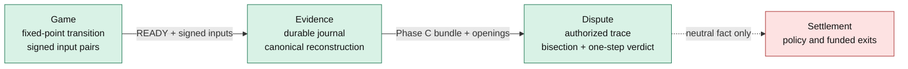

# Project map

Use this page to regain context at the start of a session. It is a map, not a
replacement for the specifications linked below.

## Sixty-second status

- **Game:** canonical fixed-point v2 simulation and signed two-player live play
  are implemented.
- **Evidence:** authenticated public inputs are committed to a durable local
  journal before use; complete journals can be reconstructed into deterministic
  transcripts and dispute bundles.
- **Dispute:** authorized Merkle trace claims, interactive bisection, and neutral
  one-step Solidity adjudication are implemented for the local test environment.
- **Settlement:** deliberately incomplete. A claimant/challenger/neither verdict
  has no payout effect, non-response has no approved resolution, and browser
  settlement remains disabled. The legacy payout paths are unsafe scaffolding.
- **Deployment:** local Hardhat chain only. Nothing in this repository authorizes
  public-chain deployment or real funds.

The dotted final arrow matters: deterministic adjudication exists, but there is
no approved mapping from that fact to money movement.

## How to read project claims

- **Current fact:** behavior present in source and tests. This map links to its
  canonical implementation or specification.
- **Accepted decision:** a deliberate architectural constraint recorded in
  [DECISIONS.md](DECISIONS.md).
- **Unresolved:** a question named in [ROADMAP.md](ROADMAP.md) or an open issue.
  An unresolved item must not be described as implemented behavior.

The cross-layer rules that current changes must preserve are in
[INVARIANTS.md](INVARIANTS.md).

## Game

**Responsibility:** turn two bounded input masks into one deterministic cumulative
state per frame, while authenticating which session key supplied each input.

| Surface | Canonical entry point | Why it matters |
| --- | --- | --- |
| Rules and transition | [`src/game.ts`](../src/game.ts) — `initialState`, `transition`, `assertValidState` | Defines fixed-point movement, combat, timer, outcome, and terminal absorption. |
| Protocol identity and state bytes | [`src/protocol.ts`](../src/protocol.ts) | Owns protocol v2, the sole rules fingerprint, ABI state encoding, and state hash. |
| Input/session cryptography | [`src/crypto.ts`](../src/crypto.ts) | Creates ephemeral session keys and hashes/signs packets and canonical frames. |
| Live lifecycle | [`src/live-match.ts`](../src/live-match.ts) — `LiveMatch` | Serializes READY/input admission, signing, durable commits, reconnect, and inspection recovery. |
| Wire schemas | [`src/live-protocol.ts`](../src/live-protocol.ts), [`src/live-discovery.ts`](../src/live-discovery.ts) | Treats PeerJS as untrusted transport and authenticates discovery/readiness. |
| Browser composition | [`src/App.tsx`](../src/App.tsx) | Connects UI, PeerJS, wallet inspection, replay, and developer artifact preparation. It is not a second rules or evidence engine. |

The numeric contract is specified in
[FIXED_POINT_PROTOCOL.md](FIXED_POINT_PROTOCOL.md). Shared packet, frame, state,
and transcript shapes are in [`src/types.ts`](../src/types.ts).

## Evidence

**Responsibility:** retain all authenticated public facts needed to reproduce a
match without trusting UI state, arrival order, or a selected transcript branch.

| Surface | Canonical entry point | Why it matters |
| --- | --- | --- |
| Durable browser journal | [`src/evidence-store.ts`](../src/evidence-store.ts) — `BrowserEvidenceStore` | IndexedDB transaction completion is the commit boundary; private keys are never persisted. |
| Packet-chain admission | [`src/match-evidence.ts`](../src/match-evidence.ts) | Separates ready, missing dependency, conflict, and invalid-chain observations. |
| Canonical reconstruction | [`src/evidence-archive.ts`](../src/evidence-archive.ts) — `reconstructEvidence` | Revalidates the entire bounded journal; conflicts never become a chosen gameplay branch. |
| Dispute bundle | [`src/evidence-trace.ts`](../src/evidence-trace.ts) — `buildEvidenceBundle`, `loadEvidenceDefense` | Produces complete states, checkpoints, tree levels, openings, and step witnesses. |
| Genesis authority | [`src/genesis.ts`](../src/genesis.ts) | Distinguishes embedded historical evidence from an independently read activated escrow record. |
| Transcript replay | [`src/verifier.ts`](../src/verifier.ts) — `verifyTranscript` | Strictly replays a supplied transcript; it does not prove that omitted journal evidence does not exist. |

[PHASE_B.md](PHASE_B.md) specifies live admission and persistence.
[PHASE_C.md](PHASE_C.md) specifies reconstruction, bundle contents, authority
modes, and the limits of local availability.

## Dispute

**Responsibility:** compare two fixed execution commitments and determine whether
the isolated transition matches the canonical rules. It produces a neutral fact,
not a payout instruction.

| Surface | Canonical entry point | Why it matters |
| --- | --- | --- |
| Trace construction | [`src/execution-trace.ts`](../src/execution-trace.ts) | Builds 301 checkpoints, ordered Merkle trees, and bounded openings under an explicit context. |
| Off-chain bisection model | [`src/bisection.ts`](../src/bisection.ts) | Preserves equal-low/unequal-high while isolating adjacent checkpoints. |
| Contract witness adapter | [`src/onchain-dispute.ts`](../src/onchain-dispute.ts) | Rebuilds independently authorized evidence before producing contract-shaped claim, midpoint, and step data. |
| Opening verification | [`contracts/TraceCommitmentVerifier.sol`](../contracts/TraceCommitmentVerifier.sol) | Checks compact ordered Merkle membership only. |
| Dispute state machine | [`contracts/TraceDispute.sol`](../contracts/TraceDispute.sol) | Freezes roots/context, runs midpoint rounds, and records claimant/challenger/neither. |
| Independent rules engine | [`contracts/GameTransitionVerifier.sol`](../contracts/GameTransitionVerifier.sol) | Verifies packet authority and executes exactly one canonical transition or terminal absorption. |

[EXECUTION_TRACE.md](EXECUTION_TRACE.md) owns the trace format and dispute
invariants. [PHASE_D.md](PHASE_D.md) owns the neutral adjudication boundary.

## Settlement and contracts

**Responsibility today:** contain an experimental equal-native-stake escrow and
provide authoritative genesis/session binding for local tests. It does **not**
provide a safe funded lifecycle.

[`contracts/CryptoFighterArena.sol`](../contracts/CryptoFighterArena.sol) owns
challenge/join, genesis registration and authorization, unactivated refunds, the
trace-dispute integration, and older result/timeout payout paths. The older
`claimResult`/`disputeResult` and gameplay timeout paths are not substitutes for
the trace protocol. [`src/chain.ts`](../src/chain.ts) exposes a deliberately small
browser ABI, while transaction actions remain disabled in the UI.

Read [GENESIS_AUTHORIZATION.md](GENESIS_AUTHORIZATION.md) for the immutable escrow
binding. Read [PROJECT_COMPLETION.md](PROJECT_COMPLETION.md) for the exact policy
gap between a neutral verdict and settlement. Issues #4–#6 own the unresolved
semantics; this map does not decide them.

## Data and authority flow

1. `transition(previousState, p1Mask, p2Mask)` defines the only canonical next
   game state.
2. Ephemeral session keys sign genesis-bound input packets. A signature proves
   the packet author, not that the packet executed.
3. `LiveMatch` commits READY/input facts before sending, acknowledging, or using
   them. Peer transport and UI state are not authorities.
4. `reconstructEvidence` validates the whole retained journal and derives an
   uncontested transcript, or returns a non-certifying status.
5. `buildEvidenceBundle` derives states, checkpoints, a trace root, and every
   opening needed for defense. A local bundle does not prove external delivery.
6. The trace contracts fix two roots, bisect to adjacent checkpoints, and execute
   one step independently. Merkle membership does not prove checkpoint truth.
7. The stored verdict has no economic effect. Settlement policy remains a
   separate, unresolved layer.

## Common category errors

- A valid transcript is not proof that all retained evidence was supplied.
- A signed future packet is not proof that the frame executed.
- A trace root or Merkle opening is not proof of correct execution.
- A historical activation record embedded in a file is not fresh chain authority.
- A `journalHash` detects replacement of a retrieved archive; it does not prove
  that the archive is available.
- A one-step claimant/challenger verdict does not certify the winning root in full.
- A deterministic verdict does not authorize a payout.
- Legacy settlement functions are not the current trace protocol.

## Validation surfaces

- `npm test`: off-chain protocol, game, evidence, and trace behavior.
- `npm run test:contract`: local EVM lifecycle, codec, dispute, and adjudication.
- `npm run test:browser`: real-browser live play, persistence, recovery, and UI
  containment.
- `npm run check`: lint, Node tests, production build, contract tests, and browser
  tests. See the README for the system-Chromium variant.
