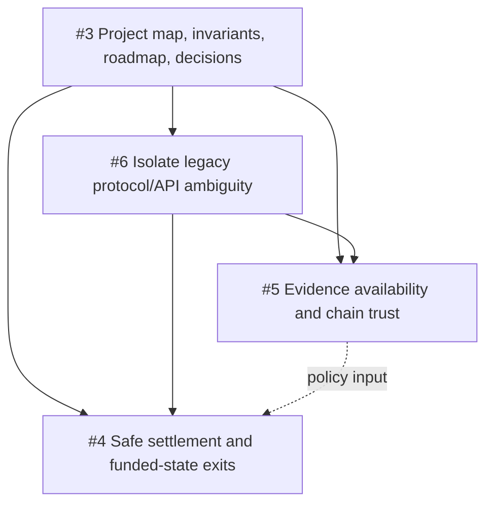

# Near-term roadmap

This is the small initial backlog after the Phase D milestone. It sequences the
known specification work; it is not a comprehensive feature plan and does not
authorize implementation.

## Current baseline

| Layer | Current state | Primary reference |
| --- | --- | --- |
| Game | Fixed-point protocol v2 and deterministic replay complete | [FIXED_POINT_PROTOCOL.md](FIXED_POINT_PROTOCOL.md) |
| Evidence | Authenticated live journal and canonical dispute bundles complete locally | [PHASE_B.md](PHASE_B.md), [PHASE_C.md](PHASE_C.md) |
| Dispute | Fixed-root bisection and neutral one-step adjudication complete locally | [PHASE_D.md](PHASE_D.md) |
| Settlement | Policy, non-response, availability, and funded exits unresolved; disabled | [PROJECT_COMPLETION.md](PROJECT_COMPLETION.md) |

## Initial backlog and dependencies

1. **[#3 Establish project map, invariants, roadmap, and decision log](https://github.com/iThompkins/crypto-fighter/issues/3)**
   creates the shared vocabulary and orientation layer. Completion means the four
   concise documents exist and point to authoritative sources without rewriting
   them.
2. **[#6 Isolate legacy protocol/API ambiguity](https://github.com/iThompkins/crypto-fighter/issues/6)**
   classifies legacy versus current trace paths, clarifies provisional versus
   finalized `matchContextHash`, and identifies misleading historical names. This
   should establish terminology before settlement behavior is specified.
3. **[#5 Specify evidence availability and chain trust assumptions](https://github.com/iThompkins/crypto-fighter/issues/5)**
   defines archive loss/withholding, evidence required to dispute, RPC trust,
   confirmations/finality, and reorg handling. Its failure categories are inputs
   to settlement semantics.
4. **[#4 Specify safe settlement and funded-state exit semantics](https://github.com/iThompkins/crypto-fighter/issues/4)**
   maps claimant/challenger/neither, non-response, both-invalid traces, and
   timeouts to objective exits for every funded state. It consumes the terminology
   and trust assumptions above. Specification comes before implementation.

Issues #4 and #5 may be drafted in parallel after the shared vocabulary exists,
but they must agree on how unavailable evidence differs from invalid evidence and
non-response. Issue #6 prevents either document from accidentally treating a
legacy payout path as current protocol.

## Settlement-enablement blockers

The project remains local-only until later, separately approved work implements
and validates all of the following:

- an approved economic meaning for unchallenged claims and each neutral verdict;
- authenticated non-response handling and an eventual exit from every funded state;
- evidence delivery/availability rules and recovery when archives are lost or withheld;
- chain finality, confirmation, RPC trust, and reorg behavior;
- claim replacement/repetition, both-invalid, and direct-fault consequences;
- removal or isolation of unsafe legacy settlement paths;
- adversarial, invariant, browser, and contract validation of the chosen policy;
- external security review before relaxing local-chain or real-fund containment.

## Deliberately outside the initial backlog

- Public-chain deployment or real-money operation.
- ERC-20/stablecoin support, fees, token economics, or governance.
- Reputation, matchmaking penalties, or behavioral scoring.
- Broad UI redesign or settlement transaction UX.
- Exhaustive API/file documentation or historical rewrite.
- Gameplay, fixed-point, trace-format, or combat-balance changes.

Add work here only when it changes near-term sequencing or blocks a funded-safety
decision. Detailed implementation task lists belong in their issue or PR.
